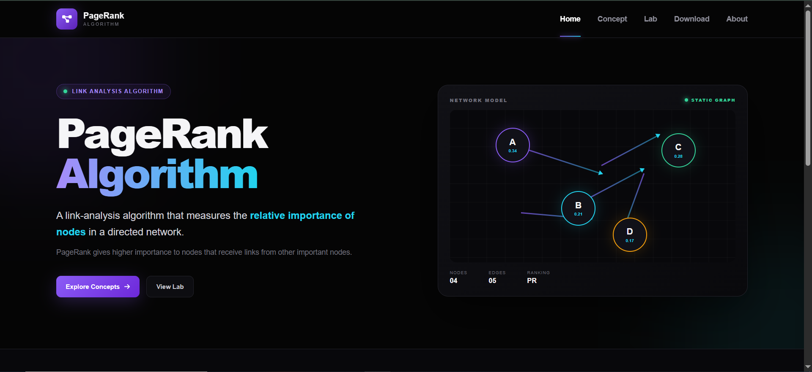

# 🔍 PageRank Algorithm 

**A learning project created while exploring the PageRank (PR) algorithm.**

## 📖 About the Project

I created this project while learning about the **PageRank (PR) algorithm**. My goal was to understand the concept, explore how it works, and present my learning through a website.

This project brings together explanations of PageRank, examples, dataset information, and practical learning resources in one place. It also reflects my learning journey in web development and my interest in understanding algorithms through practical examples.

## 🎯 Project Objectives

- Understand the basic concept of the PageRank algorithm.
- Explore how connections influence the importance of nodes in a network.
- Present algorithm-related concepts in a simple and understandable way.
- Organize learning materials into separate web pages.
- Combine web development with algorithmic learning.

## ✨ Features

- **Home Page:** Introduces the project and provides navigation to its main sections.
- **Concept Page:** Explains the PageRank algorithm and its underlying concepts.
- **Dataset Page:** Provides information related to the dataset used for learning and experimentation.
- **Lab Page:** Presents the practical implementation and demonstrates how PageRank can be explored through code.

## 🛠️ Technologies Used

| Technology | Purpose |
|---|---|
| HTML5 | Structures the website pages and their content |
| CSS3 | Handles styling, layouts, and responsive design |
| JavaScript | Adds interactive functionality to the website |
| Python | Supports practical algorithm implementation |
| NetworkX | Supports graph processing and PageRank calculations |
| Matplotlib | Supports graph visualization |

## 📁 Project Structure

```text
PR_Algorithm/
│
├── CSS/
│   ├── about.css
│   ├── concept.css
│   ├── dataset.css
│   ├── home.css
│   ├── lab.css
│   └── style.css
│
├── image/
│   ├── example.webp
│   ├── favicon.png
│   └── PageRanks-Example.svg
│
├── JS/
│   ├── concept.js
│   └── function.js
│
├── about.html
├── concept.html
├── dataset.html
├── Home.html
├── lab.html
│
├── .gitattributes
├── .gitignore
└── README.md
```

## 🧠 What Is PageRank?

PageRank is a link-analysis algorithm that estimates the relative importance of nodes in a network based on their incoming connections and the importance of the nodes linking to them.

The algorithm became well known through its use in Google's early search engine. In this project, PageRank serves as the main topic for learning about graph structures, ranking, and network relationships.

## 📚 What I Learned

Through this project, I explored:

- The fundamental idea behind the PageRank algorithm.
- How relationships between nodes form a network.
- How ranking algorithms can evaluate the relative importance of nodes.
- How algorithmic concepts can be presented through a practical learning project.


## Image:

